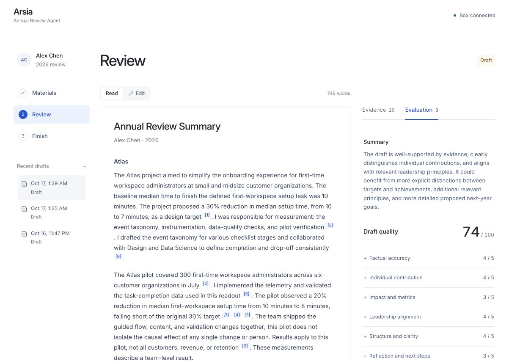
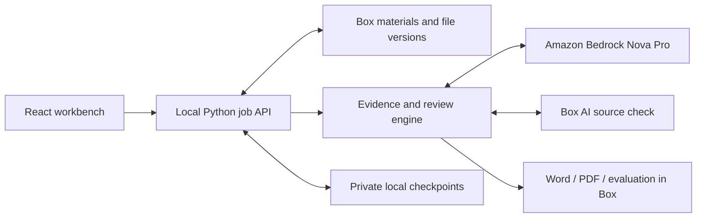

# Arsia — Box AWS Hackathon 2026

**Annual Review Agent**

[](https://github.com/younglilbird/arsia-box-aws-hackathon-2026/actions/workflows/ci.yml)

Turn project documents, peer feedback and plans in **Box** into an annual
self-review with **Amazon Bedrock**. Inspect the evidence, add missing context,
improve the same draft, and save professional Word/PDF reports back to Box.

Built during the **Agentic Enterprise AI Hackathon with Box + AWS**, October
16–17, 2026. This repository is the source-code submission.

**Presentation demo:** run the local workbench at **http://127.0.0.1:8765/**
with real Box and AWS services and fictional demonstration materials. Follow
[Run locally](#run-locally) below and the [three-minute demo script](docs/demo-script.md).
Optional cloud hosting is documented in [hosting and access](docs/hosting.md).



[Enterprise value and reuse](docs/enterprise-value.md)

**Explore without credentials:** [Word report](examples/annual-review.docx)
· [PDF report](examples/annual-review.pdf) · [Evaluation](examples/evaluation.docx)
· [Three-minute demo script](docs/demo-script.md).

## What it does

1. **Collect materials.** Upload Word/PDF documents into Projects, Peer Feedback
   or Annual Plans, or choose files from another Box folder. Imports copy a
   pinned version into an independent workspace; originals stay intact.
2. **Select useful evidence.** Extract literal source quotations and curate at
   most 20 important facts, prioritizing contribution, impact and feedback.
   Distinguish design targets from measured results and personal work from team outcomes.
3. **Write, evaluate and revise.** Generate a report, evaluate it, revise it,
   then independently evaluate the exact final text. Box AI supplies an
   additional source check. The interface shows the current assessment.
4. **Improve the same draft.** Guidance asks for missing information. Answers
   patch the existing report, preserve unrelated writing and trigger a fresh
   evaluation. Further questions support another manual round. Targets of
   90 or 95 are advisory, not promised scores.
5. **Review and deliver.** Edit the report, explicitly mark it reviewed, and
   save editable Word/PDF files in Box. Formal reports omit evidence markers;
   source connections remain in the interface.

The report contains **Annual Review Summary**, **Leadership Principles
Summary**, **Next Year Goals**, and **Peer Feedback Summary**. Projects use
complete paragraphs. Amazon's 16 Leadership Principles guide supported
connections without requiring every principle. Scores assess document quality,
not employee performance or promotion eligibility.

Materials and recent drafts have confirmation-based deletion. Removing an
imported material deletes only its workspace copy. Removing a draft also removes
its tracked generated Box files. Incomplete deletions remain retryable; the app
never purges Box Trash.

## How Box and AWS are used



| Technology | Responsibility |
| --- | --- |
| Box API | Categorized materials, pinned imports, source downloads, output versions and recoverable deletion |
| Box AI | Additional review against original files; advisory findings |
| Amazon Bedrock Nova Pro | Evidence extraction, writing, independent evaluations and guided improvements |
| React, TypeScript, Vite | Minimal workbench, editing, evidence review and employee guidance |
| FastAPI, Python | Jobs, scope/version checks, private checkpoints and document exports |
| EC2, CloudFront, Systems Manager | Persistent demo runtime, public HTTPS entry point and administration without inbound SSH |
| Secrets Manager, IAM, CloudFormation | Private runtime configuration, scoped workload identity and reproducible hosting infrastructure |
| Existing AWS deployment | Earlier private Lambda worker, S3 state, Secrets Manager and execution-role access; schedule disabled |

The local workbench uses the signed-in AWS profile. The hosted workbench uses
its EC2 instance role. The earlier Lambda worker uses its execution role;
current workbench changes have not been redeployed to that historical worker.
Box Relay is optional.

## Run locally

Prerequisites: **Python 3.12**, **Node.js 24**, **pnpm 11.25.0**, an authorized
Box Developer application and an AWS identity with access to the configured
Bedrock model. The shell launcher is intended for macOS/Linux.

```sh
git clone https://github.com/younglilbird/arsia-box-aws-hackathon-2026.git
cd arsia-box-aws-hackathon-2026
python3.12 -m venv .venv
.venv/bin/python -m pip install -r requirements-local.txt
cp .env.example .env
```

Fill in the ignored `.env` file locally:

- `BOX_CLIENT_ID`, `BOX_CLIENT_SECRET`, `BOX_ENTERPRISE_ID` and `BOX_USER_ID`.
  The workbench uses the configured human Developer user's content space;
  the application's service account has a separate content space.
- `AWS_PROFILE` if using a named authenticated profile, `AWS_REGION=us-east-2`
  and `BEDROCK_MODEL_ID=us.amazon.nova-pro-v1:0`.

Create the fictional demo workspace once, then launch:

```sh
.venv/bin/python scripts/setup_box_demo.py
pnpm --dir frontend install --frozen-lockfile
bash scripts/start_local.sh
```

Open **http://127.0.0.1:8765/** and keep the terminal running. Setup uploads nine
fictional Word/PDF files and writes private folder configuration under `.local/`.
Reuse an existing configured workspace; do not seed another copy just to open
the app. The launcher supports `PYTHON_BIN`, `NODE_BIN` and `PNPM_BIN` overrides.

```text
Annual Review - Alex Chen - 2026/
  Projects/
  Peer Feedback/
  Annual Plans/
  Reports/
```

Generation starts only after an explicit action. Opening the page or checking
progress does not start model work. It can take several minutes; use an
identified, previously completed run during a three-minute presentation.

## Quality and verification

```sh
.venv/bin/python -m pip install -r requirements-dev.txt
.venv/bin/python -m pip check
.venv/bin/python -m ruff check app scripts tests
.venv/bin/python -m pytest -q
pnpm --dir frontend test
pnpm --dir frontend run build
.venv/bin/python scripts/check_repository.py
.venv/bin/python scripts/export_prompts.py
```

GitHub Actions runs Python and frontend checks without Box/AWS credentials or
model charges. `constraints.txt` records tested Python versions;
`frontend/pnpm-lock.yaml` locks frontend dependencies. Prompt documentation is
generated from actual application strings and checked for drift.

Review covers literal quotations, citation IDs, numeric formats, source
versions, file scope, repeated improvements, partial uploads, recovery and
cross-tab editing. Edits, confirmation and improvement require the expected
report hash, so a stale tab cannot overwrite or approve newer content.
Real Box/Bedrock integration checks are documented separately from offline tests.

| Guide | Contents |
| --- | --- |
| [Code review](docs/code-review.md) | Findings, fixes, verification and remaining engineering limits |
| [Architecture](docs/architecture.md) | Runtime, credentials, AWS resources and deployment |
| [Evaluation](docs/evaluation.md) | Writing guide, scoring dimensions and improvement behavior |
| [Actual prompts](docs/prompts.md) | Extraction, writing, evaluation and patch instructions |
| [Development checks](docs/development-checks.md) | Measured local, Box and AWS results |
| [Acceptance checklist](docs/acceptance-checklist.md) | Requested behavior and implementation status |
| [Submission guide](docs/submission-guide.md) | GitHub, local demo, hosting and final preparation |

## Current limits

The presentation runs as a **single-user local prototype**. Credentials remain
in Python, outside the browser and Git. The optional hosted demo uses a shared
login; enterprise multi-user access still requires individual authorization
and user-to-Box isolation.

Inputs are readable Word or text-based PDF, up to 25 supported files and 12 MB
per file, with additional text/chunk/repair budgets. OCR is not implemented.
Each improvement round adds an answer document and uses an input slot.
Box snapshots do not automatically refresh from their originals.

The demo sources are short. Advanced retrieval, persistent extraction caching
and long-document benchmarks remain a [design proposal](docs/long-document-design.md).
Literal matches establish traceability, not semantic or causal proof. Employees
still review contribution, interpretation and commitments.

Normal shutdown waits; forced termination can interrupt work. Browser attachment
responses are verified, but automatic saving to the download directory was not
established in the controlled session. The sample documents above are available
for inspection and can be opened in Box during the live demo.
Never commit `.env`, `.local`, credentials or real employee records.
