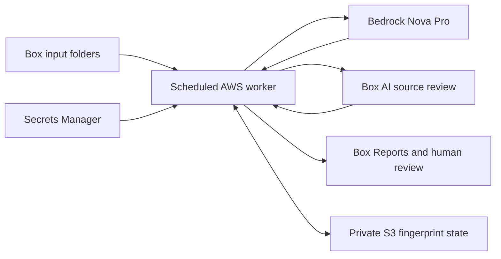

# Architecture

The employee uses the existing Box interface. Projects, Peer Feedback and
Annual Plans are the only input categories; Reports is the output folder.
AWS runs the background processing. There is no employee-facing external
website and no public callback endpoint.



## Input boundary and change detection

Private configuration names one employee, one review year, three input folder
IDs and a Reports folder ID. The worker recursively discovers `.docx` and
text-based `.pdf` documents within those input folders. Reports is excluded by
ID, including if moved beneath an input folder, so generated files cannot
become their own evidence.

A fingerprint includes file IDs, versions, categories, names and sizes. The
first poll after a change records the pending fingerprint. A later poll may
start generation after at least 20 seconds without a detected change. With a
one-minute schedule, quiet time is checked at polling boundaries; processing
does not start exactly 20 seconds after every upload.

An unchanged completed fingerprint does not run the model again. Failed or
interrupted processing requires operator attention rather than an automatic
loop of repeated model charges. After fixing the problem, a changed input
version can trigger a new attempt. Reserved concurrency of one serializes
the worker's state claims.

Immediately before uploading reports, the worker lists the input folders again
and compares their fingerprint with the generation snapshot. If a source
changed during generation, it publishes no draft from that run. The old input
version is marked failed, while the updated inputs can settle and generate on
later polls.

## Generation and review

1. Download and extract readable text. Preserve category, file identity and
   version metadata; record exclusions and truncation.
2. Extract claims with source quotations, status and attribution. Code checks
   that retained quotations occur in the extracted source text.
3. Draft the annual self-review with evidence IDs such as `[E1]`. Code rejects
   nonexistent evidence references.
4. Ask Box AI to review the draft against original Box files. Its findings are
   advisory. If unavailable, the Bedrock source-based reviewer continues.
5. Have Bedrock review the complete draft and sources for factual support,
   personal versus team contribution, expected versus measured impact and
   missing information. Perform at most one revision.
6. Upload draft Word, draft PDF and review-notes Word files to Reports. The
   report has a compact index of cited files; review notes preserve fuller
   evidence and the review trail.

Project designs establish scope and intended impact; measured readouts support
observed results. Peer feedback supports qualitative observations about work
and collaboration, not a substitute product metric. Annual Plans describe
proposed priorities, not completed achievements.

Quotation and citation checks establish traceability, not the truth of every
model interpretation. The employee must review facts, contribution, personal
reflection and commitments in Box. The worker never records human approval.

A source can still change after the final check or after publication. Report
citations open the current Box file rather than a permanently pinned version;
review notes preserve the extracted quotations for comparison. Box AI also
reviews source file IDs, so its feedback remains advisory when versions change.

## Runtime limits

The workflow analyzes at most 25 Word/PDF documents, each up to 12 MB, and
traverses at most 100 folders. The generation engine has additional text,
chunk and extraction-call budgets. Review notes record coverage and omitted
materials. Image-only PDFs need OCR before this implementation can read them.

Writing targets approximately 800 to 1,050 English words for a two- to
three-page report. Actual page count depends on content, headings, citations
and renderer. Full evidence is kept outside the compact report.

## AWS resources and credentials

| Resource | Responsibility |
| --- | --- |
| EventBridge rule | Invoke the worker every minute |
| Private Lambda | Run one worker at a time with a bounded execution timeout |
| Bedrock Nova Pro | Extract, write, review and optionally revise |
| Secrets Manager | Store CCG credentials and configured Box folder IDs |
| Private S3 bucket | Store the deployment ZIP and small operational state |
| Execution role | Permit the specific secret, state object, model resources and required service operations |

S3 state contains fingerprints, stages, report IDs and counts. Source bodies,
complete model output and Box secrets are not written there. State writes
request server-side encryption; the template blocks public bucket access and
denies non-TLS requests. The handler logs bounded summaries rather than
document text or provider errors containing sensitive details.

Local development uses the SDK's developer credential chain and an optional
named profile. The cloud handler sets `aws_profile=None` and relies on its
Lambda execution role. Developer login credentials are not uploaded to Lambda.
Box CCG obtains fresh tokens; an authorized `BOX_USER_ID` selects the human
content space used by the native demo.

The handler reads native configuration from Secrets Manager, not invocation
payloads. Environment values name `REVIEW_SECRET_ARN`, `REVIEW_STATE_BUCKET`
and `BEDROCK_MODEL_ID`; AWS supplies the runtime region. No Box client secret
is an environment value. The deployment role and Lambda execution role have
different responsibilities.

## Deployment procedure

These commands provision and change resources in the signed-in AWS account.
Use the intended account and region. Template validation and offline tests
are not proof that a deployed worker can generate a report.

First build Linux dependencies and the deployment ZIP:

```sh
.venv/bin/python -m pip install -r requirements-lambda.txt \
  --platform manylinux_2_28_x86_64 --platform manylinux2014_x86_64 \
  --python-version 3.12 --implementation cp --only-binary=:all: \
  --target work/lambda-package
.venv/bin/python scripts/build_lambda.py \
  --dependencies work/lambda-package --output work/native-worker.zip
```

Bootstrap an inert stack. Its schedule stays disabled until code and
configuration are uploaded:

```sh
aws cloudformation create-stack --region us-east-2 \
  --stack-name box-annual-review-hackathon \
  --template-body file://infra/template.yaml --capabilities CAPABILITY_IAM \
  --parameters ParameterKey=ArtifactKey,ParameterValue= \
    ParameterKey=ScheduleEnabled,ParameterValue=false
aws cloudformation wait stack-create-complete --region us-east-2 \
  --stack-name box-annual-review-hackathon
.venv/bin/python scripts/configure_cloud.py \
  --stack-name box-annual-review-hackathon --artifact work/native-worker.zip
```

The configuration helper uses the stack outputs to put Box credentials and
native folder configuration into Secrets Manager. It uploads the ZIP to the
private stack bucket, initializes state only when missing, and writes a
non-secret deployment summary to `.local/deployment.json` with mode `600`.
It requires the local CCG values and human `BOX_USER_ID`. It never prints the
client secret or overwrites an existing state object.

Replace `ARTIFACT_KEY_FROM_HELPER` with its printed `artifact_key`, then enable
the packaged worker:

```sh
aws cloudformation update-stack --region us-east-2 \
  --stack-name box-annual-review-hackathon \
  --template-body file://infra/template.yaml --capabilities CAPABILITY_IAM \
  --parameters ParameterKey=ArtifactKey,ParameterValue=ARTIFACT_KEY_FROM_HELPER \
    ParameterKey=ScheduleEnabled,ParameterValue=true
aws cloudformation wait stack-update-complete --region us-east-2 \
  --stack-name box-annual-review-hackathon
```

Verify the function, role, schedule, Box root status and real report uploads.
Keep an input set unchanged while the first generation completes. Inspect
the resulting Word/PDF and review notes in Box before treating deployment
verification as complete.

For a code update, rebuild, run the configuration helper again and update the
stack with the new artifact key. State and secrets are retained by the
template on stack deletion; removing a stack is not a complete data cleanup.

## Demo configuration

`scripts/build_demo_documents.py` produces real inputs from the versioned
synthetic sources. `demo-materials/manifest.json` assigns files to categories.
`scripts/setup_box_demo.py` creates or reuses the dedicated Box folders,
uploads documents with their actual MIME types, and saves non-secret IDs to
ignored `.local/native-config.json` with mode `600`. It does not overwrite
different existing content.

## Optional Box Relay review

**Configuration status: Active, confirmed in the Box UI and API on October 16,
2026. Manual-start execution has not been verified.** The employee's baseline
review path is Box preview, comments and the native **Add Task** action. The
optional Relay workflow is configured as follows:

| Setting | Value |
| --- | --- |
| Workflow name | Annual Review - Employee Review |
| Trigger | Manual Start on a selected file in Reports |
| Outcome | General Task |
| Assignees | Specify When Started |
| Task target | The file that triggered the workflow |
| Verified inspection path | Reports → Details → Workflows → Annual Review - Employee Review |
| Execution status | Not yet verified; no Relay review task was started |

The verified Details entry opens a read-only workflow modal with Back and Close
controls. It does not start a task. Box's official manual-start guide describes
the expected launch path as a file's ellipsis menu → **Start a Workflow** →
select the workflow → fill required assignees → **Start**. The file menus in
this account did not expose that action, and multi-file selection did not
resolve it. This documented path must not be presented as working in the demo
until it is tested successfully.

For the demonstrated review, open the report in Box, follow its source links,
read review notes, comment and use **Add Task** to request review from an
authorized person. The reviewer compares the report with its cited originals
and completes their review in Box.

This is a General Task for human review, not an automatic approval step. It
does not cause the AWS generator to mark its draft approved or regenerate
from comments. An updated input document can independently trigger a new
draft through normal polling. Box documents the
[manual-start UI](https://support.box.com/hc/en-us/articles/360044628853-Creating-and-Running-a-Manual-Start-Workflow)
and [task options](https://support.box.com/hc/en-us/articles/360043695874-Understanding-Triggers-and-Outcomes-in-Relay).

The current enterprise exposes the Relay editor rather than the Box Automate
visual canvas, and its Admin Console has no Connectors tab. Ask the organizers:
**Can the current Automate canvas, HTTPS custom connectors and AI steps be
enabled for this Developer enterprise during the hackathon, and which
entitlement or provisioning change is required?** The deployed generation
workflow runs through private AWS polling and does not depend on those features.
